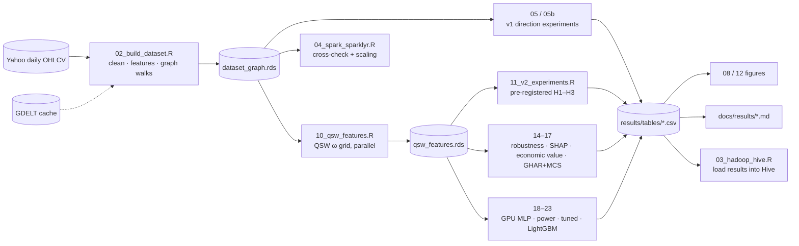
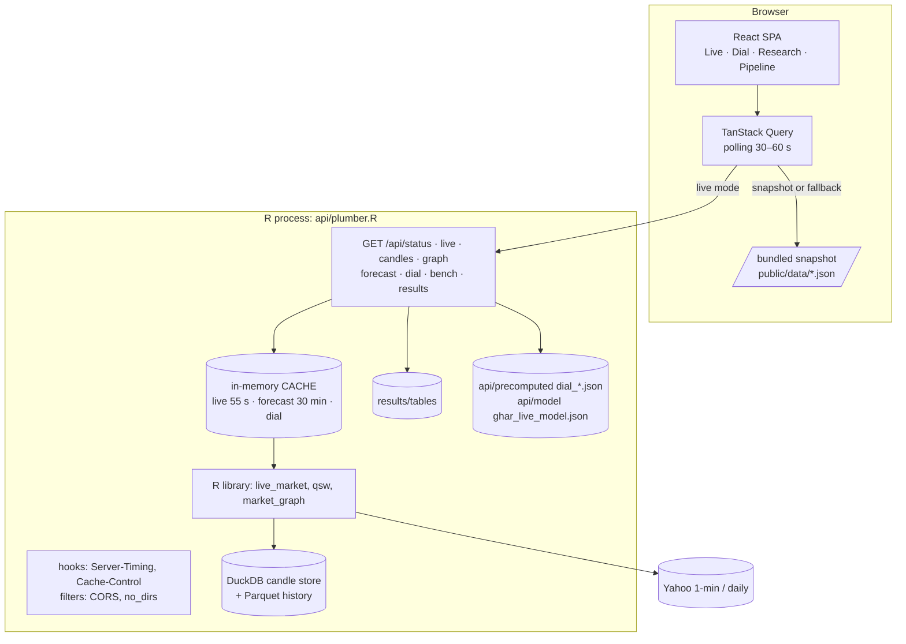
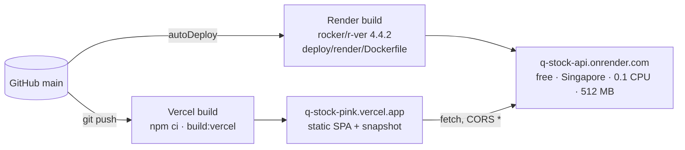

# Q-Stock: system architecture

Status: describes the system as built on 2026-10-25 (commit `9f9f3c7`).
Companion documents: [`../design/DESIGN.md`](../design/DESIGN.md) (module design, algorithms, data model, API contract, decisions) and [`../operations/runbook.md`](../operations/runbook.md) (how to run it).

## 1. Purpose and scope

Q-Stock is a Big Data research framework that tests whether **classically simulated quantum walks** on market-correlation graphs carry forecasting information for equities. It has three faces:

1. **Research pipeline** (batch, offline): builds a leakage-controlled dataset for 20 NSE + 20 NASDAQ large caps (2015-01 to 2026-10), computes classical, classical-diffusion and quantum-walk features, and runs pre-registered walk-forward experiments.
2. **Big Data layer** (course component, CSE 465): HDFS, Java MapReduce, Hive and Spark (sparklyr) reproduce and cross-check parts of the pipeline at scale.
3. **Serving layer**: an R plumber API, a Shiny dashboard and a React + three.js web UI show live intraday markets, the quantum dial and the research results. Deployed on Render (API) and Vercel (UI), both free tiers.

Hard constraints that shape the architecture:

| Constraint | Consequence |
|---|---|
| Course rule: analysis in R, no PySpark | All computation is R; Spark is driven through sparklyr; MapReduce is Java (Hadoop's own language) |
| Lab environment is the Cloudera QuickStart VM (CDH 5.13, Spark 1.6, Java 7) | HDFS/MapReduce/Hive run in the VM; Spark 3.5 runs on the host because sparklyr cannot drive Spark 1.6 |
| No quantum hardware | Quantum walks are dense/sparse linear-algebra simulations (base R, torch CPU/CUDA for the benchmark) |
| Free data only | Yahoo chart API (daily + 1-minute bars), GDELT DOC 2.0 for sentiment |
| Free hosting | R API on Render free (0.1 CPU, 512 MB, sleeps after 15 min); UI on Vercel with a static-snapshot fallback |
| Research integrity | Pre-registration, embargoed walk-forward, live data never enters research datasets |

## 2. System context

```mermaid
flowchart LR
  user([Researcher / viewer])
  subgraph ext[External sources]
    yahoo[(Yahoo chart API<br/>daily + 1-min bars)]
    gdelt[(GDELT DOC 2.0<br/>news tone)]
  end
  subgraph laptop[Development laptop: Windows 11, i7-13650HX, RTX 4060]
    rpipe[R research pipeline<br/>R/ + scripts/]
    spark[Spark 3.5.9 local[8]<br/>via sparklyr]
    gpu[torch for R + CUDA<br/>benchmark / MLP]
    shiny[Shiny dashboard<br/>app/ :8050]
    apiL[R plumber API<br/>api/ :8000 + web/dist]
    vm[Cloudera QuickStart VM<br/>HDFS · YARN · MapReduce · Hive]
  end
  subgraph cloud[Free cloud hosting]
    render[Render: R API<br/>Docker, deploy/render]
    vercel[Vercel: React UI<br/>web/dist-vercel]
  end
  yahoo --> rpipe & apiL & render & shiny
  gdelt --> rpipe
  rpipe <--> spark
  rpipe <-- WebHDFS / ssh+beeline --> vm
  rpipe --> gpu
  user --> shiny & apiL & vercel
  vercel -- HTTPS JSON, CORS --> render
```

## 3. Logical architecture (layers)

```mermaid
flowchart TB
  subgraph L1[1 · Ingestion]
    da[data_adapter.R<br/>fetch / parse / clean prices]
    sg[sentiment_gdelt.R<br/>tone timelines + cache]
    lm1[live_market.R<br/>1-min polling, curl multi]
  end
  subgraph L2[2 · Storage]
    raw[(data/raw<br/>prices_yahoo.csv, gdelt_cache)]
    cur[(data/curated<br/>dataset_graph.rds, qsw_features.rds)]
    hdfs[(HDFS /user/cloudera/qstock)]
    hive[(Hive external tables)]
    sqlite[(data/live/candles.duckdb + parquet/<br/>hot/cold candle store)]
    res[(results/<br/>tables, figures, predictions, logs)]
  end
  subgraph L3[3 · Computation core: R library]
    graph[market_graph.R<br/>kNN correlation graph, walks]
    qw[dtqw.R · ctqw.R · qsw.R<br/>quantum-walk simulators]
    feat[features.R · qsw_features.R · dataset.R]
    wf[walk_forward.R · baseline_logit.R]
    ev[evaluation.R<br/>DM, Holm/BH, bootstrap, QLIKE]
  end
  subgraph L4[4 · Orchestration]
    scripts[scripts/01–27 numbered steps]
    chains[overnight_*.sh, after_*.sh<br/>thermal_guard.ps1, monitor_system.ps1]
  end
  subgraph L5[5 · Presentation]
    plumber[api/plumber.R REST]
    shinyapp[app/app.R Shiny]
    web[web/ React + three.js]
    paper[docs/ + paper/]
  end
  L1 --> L2 --> L3 --> L2
  L4 --> L3
  L2 --> L5
  L3 --> plumber
```

The R library in `R/` is the single computation core. Every entry point (scripts, tests, Shiny, plumber, Docker image) sources all of `R/*.R` and shares `QS` from `R/config.R`.

## 4. Research pipeline (batch data flow)



Pipeline invariants (enforced by code and tests):

* **Point-in-time features.** Every feature at date *t* uses data up to the close of *t*. Unit tests perturb future rows and assert features are unchanged.
* **Embargoed walk-forward.** 24-month rolling train window, monthly test folds from 2017-03; training rows whose label date falls inside the test month are dropped (5 trading days for the 5-day RV target).
* **Matched controls.** Classical random walk, heat kernel, PageRank, DTQW, CTQW and QSW all run on the *same* graph and produce the *same* feature definitions (`self`, `mom`, `ent`, `volspill`), plus a random-graph control.
* **Pre-registration.** The v2 ω grid, targets, tests and corrections were fixed in `docs/research/preregistration_v2.md` before any v2 run. Everything else is labelled exploratory.

## 5. Big Data layer

```mermaid
flowchart LR
  subgraph host[Windows host]
    r[R: hadoop_bridge.R]
    sp[Spark 3.5.9 local[8]<br/>Java 17 · winutils]
  end
  subgraph vm[Cloudera VM 5.13 · CentOS 6.7 · 8 GB / 4 vCPU]
    nn[NameNode / DataNode<br/>repl 1, 128 MB blocks]
    yarn[YARN]
    mr[QStockMonthlyStats.java<br/>mapper · combiner · 2 reducers]
    hs2[HiveServer2 :10000<br/>metastore :9083 MySQL]
    cm[Cloudera Manager REST v18]
  end
  r -- WebHDFS REST :50070 --> nn
  r -- ssh :2222 → beeline / hadoop jar --> yarn & hs2
  yarn --> mr --> nn
  hs2 --> nn
  r -- ssh: vm_start_services.sh --> cm
  r <-- sparklyr --> sp
```

| Component | Role | Validation |
|---|---|---|
| HDFS | Stores curated prices, code, experiment results and predictions under `/user/cloudera/qstock` | DataNode include-list fix re-applied on every boot |
| MapReduce (Java) | Per ticker-month statistics with a combiner and custom counters | 5,680 groups match R exactly (max error 1.8×10⁻¹⁵) |
| Hive | External tables `prices`, `mr_monthly_stats`, `sentiment_daily`, `experiment_results`, `predictions`; window-function queries | MR-vs-raw consistency query: 0 mismatches |
| Spark (sparklyr) | Rolling-window features and point-in-time sentiment range join; scaling to 7.49 M rows | Agrees with R to 10⁻¹⁵ / 6.5×10⁻⁷; 4.8 s at 7.49 M rows |

## 6. Serving architecture

### 6.1 Components



* **Computation stays in R.** The UI only renders API responses; types in `web/src/lib/api.ts` mirror `api/plumber.R`.
* **One shared fetch per market per minute.** All viewers read the same cached Yahoo batch; the API never fans out per browser tab.
* **Stale-but-available.** If a Yahoo fetch fails, the last good batch is served with `stale: true`.
* **Live/research separation.** Live candles go only to `data/live/` (DuckDB + Parquet); nothing in the research pipeline reads it.

### 6.2 Three UI build modes

| Mode | Build | Data source | Used for |
|---|---|---|---|
| Local live | `npm run build` → `web/dist`, served by plumber on :8000 | Same-origin `/api/*` | Development, demo on the laptop |
| Static snapshot | `25_export_snapshot.R` → `web/public/data`, `npm run build:snapshot` → `dist-snapshot` | `/data/*.json` only | Hosting without R |
| Remote live (Vercel) | `npm run build:vercel` → `dist-vercel`, `VITE_API_URL` set | Render API, **falls back to the snapshot** while the API sleeps or fails | Public site |

### 6.3 Shiny dashboard

`app/app.R` (bslib `page_navbar`) is the R-native dashboard: Overview, Live market, Quantum dial (live), Volatility forecasts, Results (sub-tabs), Big Data pipeline, System health. It uses the same `R/live_market.R` functions as the API, with plotly candlesticks and visNetwork graphs. `?tab=` selects a tab from the URL.

## 7. Deployment topology



| Item | Value |
|---|---|
| API image contents | `R/`, `api/plumber.R`, `api/run_api.R`, `api/model`, `api/precomputed`, `results/tables`. No raw or curated data; prices download at image build |
| Runtime settings | `OPENBLAS_NUM_THREADS=1`, `OMP_NUM_THREADS=1` (8 BLAS threads on 0.1 CPU made a 20-node QSW take 39 s; 2.0 s single-threaded); `QSTOCK_HOST=0.0.0.0`; no HTTP health check (it restarted the single-threaded server mid-computation) |
| Measured on Render | live quotes ≈ 11 s, live graph ≈ 6 s, forecast ≈ 5 s, dial 0.1–4 s; ≈ 230 MB RAM |
| Cache headers | `/assets/*` immutable for a year; `index.html` `no-cache`; `/data/*` 5 min on Vercel |
| Alternative kept | `deploy/hf-space` + `scripts/27_build_hf_space.sh` for Hugging Face Docker Spaces (paid since mid-2026) |

## 8. Cross-cutting concerns

| Concern | Approach |
|---|---|
| **Reproducibility** | Fixed `end_date` in `QS`; cached raw data; numbered scripts; session info saved per stage (`results/*_sessionInfo.txt`); every doc number traceable to a CSV |
| **Correctness** | 42 testthat blocks / 187 expectations: unitarity, Hermiticity, QSW limits (ω = 0 → CTQW, ω = 1 → heat kernel, to 10⁻⁶), leakage perturbation, embargo, candle store, tick aggregator; 20 offline API end-to-end checks; Shiny server tests; `tsc -b` |
| **Statistical integrity** | DM tests with Newey–West variance, Holm within pre-registered families, BH for ablations, stationary bootstrap CIs, Model Confidence Set, power analysis with injected signals |
| **Resource safety** | Thread caps (ranger 4, Spark `local[8]`, VM 4 vCPU of 20 threads); `thermal_guard.ps1` suspends R/Java and pauses the VM at GPU ≥ 87 °C, resumes ≤ 65 °C; Cloudera Management Service stopped to keep the VM responsive |
| **Long runs** | Unattended shell chains with explicit R exit-status checks and `===` step markers in the log |
| **Observability** | `Server-Timing` header on every API response; `/api/bench`; `monitor_system.ps1` health CSV; per-step logs in `results/` |
| **Security** | Read-only GET API with `Access-Control-Allow-Origin: *`; no secrets in the UI (`VITE_API_URL` is public); third-party `winutils` binaries hash-recorded |

## 9. Technology stack

| Layer | Technology |
|---|---|
| Language / core | R 4.6.1 (host), R 4.4.2 (container); base R linear algebra, `Matrix` for sparse DTQW |
| ML / stats | `stats` (OLS, logit), ranger, glmnet (elastic net), lightgbm, torch for R (MLP, CUDA benchmark) |
| Big Data | Hadoop 2.6 / YARN, Java MapReduce (JDK 1.7), Hive 1.1, Spark 3.5.9 via sparklyr 1.9.6, WebHDFS |
| Storage | CSV/RDS files, HDFS, Hive (MySQL metastore), DuckDB + Parquet (live candles, daily-price cache), SQLite rollback (PostgreSQL-compatible SQL) |
| API | plumber, jsonlite, curl (multi), duckdb/DBI, RSQLite (rollback) |
| Dashboards | Shiny + bslib, plotly, visNetwork, DT; chromote for screenshots |
| Web UI | React 18, TypeScript 5.6, Vite 5, Tailwind 3, TanStack Query 5, three.js / react-three-fiber, d3-force-3d, lightweight-charts, recharts, framer-motion |
| Deployment | Docker (rocker/r-ver), Render Blueprint (`render.yaml`), Vercel (`web/vercel.json`) |
| Automation | Git Bash scripts, PowerShell (thermal guard, monitor), VirtualBox `VBoxManage` |
