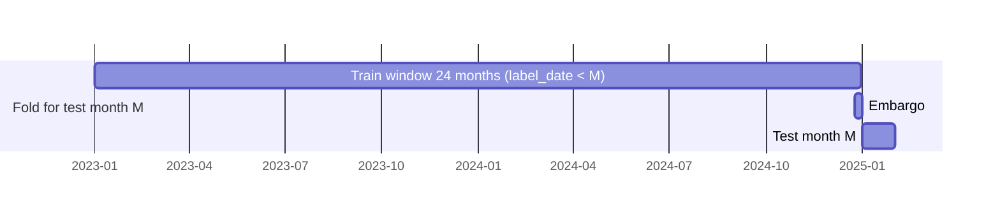
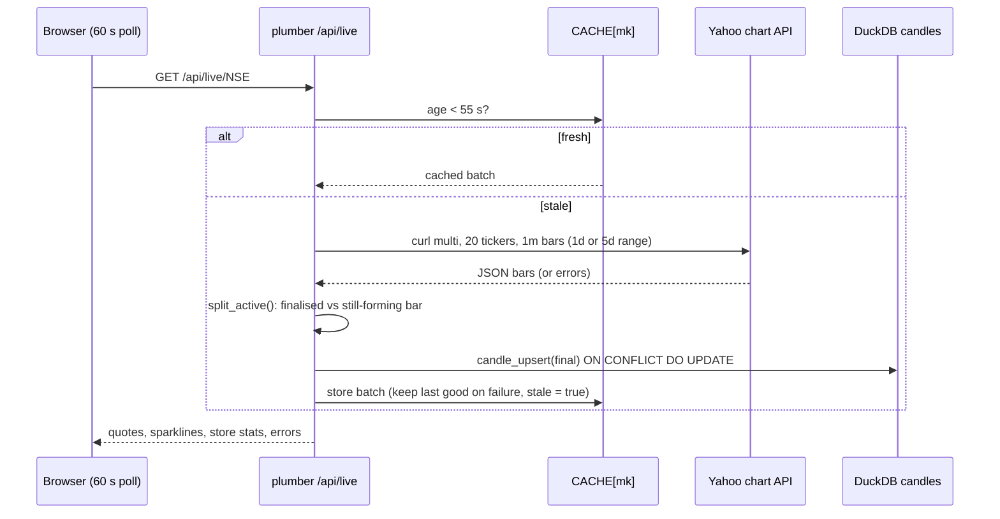

# Q-Stock: detailed design

Status: as built on 2026-10-25. Read [`../architecture/ARCHITECTURE.md`](../architecture/ARCHITECTURE.md) first for the big picture.
This document covers module responsibilities, algorithms, data model, the API contract, the UI, testing, and the design decisions with their reasons.

## 1. Module map (`R/`)

Every entry point sources all of `R/*.R`; there is no package build. Configuration lives in one list, `QS` (`R/config.R`), plus `LIVE` (`R/live_market.R`).

| Module | Responsibility | Key functions |
|---|---|---|
| `config.R` | Dates, universes (20 NSE + 20 NASDAQ), graph and walk-forward settings, column groups | `QS`, `CLASSICAL_COLS`, `GRAPH_METHODS`, `graph_cols()`, `SENTIMENT_COLS` |
| `data_adapter.R` | Yahoo daily download, parsing, cleaning (holiday bars, NA-safe), cache in `data/raw/prices_yahoo.csv` | `fetch_yahoo_daily`, `parse_yahoo_daily`, `clean_prices`, `load_market_data` |
| `synthetic_data.R` | GARCH price simulator, **software validation only** | `simulate_garch_prices` |
| `features.R` | Classical per-stock features with trailing (past-only) windows | `trailing_mean`, `trailing_sd`, `build_features` |
| `market_graph.R` | Correlation kNN graph per date; five walk/diffusion processes; node features | `knn_graph`, `walk_distributions`, `node_features_from_P`, `graph_features_market` |
| `dtqw.R` | Grover-coin DTQW on graph arcs (dense and sparse) and on a cycle | `dtqw_graph_operator(_sparse)`, `dtqw_evolve`, `is_unitary` |
| `ctqw.R` | CTQW with H = L | `ctqw_hamiltonian`, `ctqw_propagator`, `ctqw_probs`, `is_hermitian` |
| `qsw.R` | Quantum stochastic walk (Lindblad), RK4 on batched density matrices; exact limits | `qsw_rhs`, `qsw_distributions`, `qsw_trace`, `qsw_purity` |
| `qsw_features.R` | v2 QSW features, GHAR regressors, RV targets | `qsw_features_market`, `ghar_features_market`, `build_vol_targets`, `omega_tag` |
| `sentiment_gdelt.R` | GDELT tone timelines, per-ticker cache, point-in-time decay features | `gdelt_timeline`, `load_sentiment`, `sentiment_features` |
| `dataset.R` | Joins features, regimes and fusion interactions into the modelling table | `build_dataset`, `add_regime`, `add_fusion_interactions` |
| `walk_forward.R` | Monthly folds, embargoed split, train-only scaling, fit/predict loop | `walk_forward_folds`, `wf_split`, `fit_predict`, `walk_forward(_reg)` |
| `baseline_logit.R` | Stage-1 chronological logit baseline | `chrono_split`, `fit_logit_baseline` |
| `evaluation.R` | Metrics, backtest, DM test, bootstrap CI, Holm/BH, QLIKE, rank IC | `dm_test`, `stationary_boot_ci`, `holm_adjust`, `bh_adjust`, `qlike`, `rank_ic`, `backtest` |
| `hadoop_bridge.R` | WebHDFS REST client and VM ssh helper | `hdfs_put`, `hdfs_ls`, `hdfs_get_text`, `vm_ssh` |
| `live_market.R` | Sessions, 1-min polling, candle store, tick aggregator, live graph, live GHAR forecast | `market_status`, `fetch_intraday_many`, `candle_upsert`, `tick_aggregator`, `live_graph`, `ghar_live_forecast` |

## 2. Algorithms

### 2.1 Market-state graph (per market, per date *t*)

1. Daily log returns; correlations over the trailing `corr_window = 60` days ending at *t* (known at the close of *t*). A stock enters the graph only if ≥ 80% of the window is observed.
2. kNN with `knn_k = 4` on the highest correlations, symmetrised by `max(A, Aᵀ)`.
3. Edge weights `W_ij = max(ρ_ij, 0.01)` so the graph is positive and connected locally.
4. Laplacian `L = D − W`, `D = diag(rowSums(W))`.

A **random-graph control** (`graph = "random"`, fixed seed) replaces ρ with a random symmetric matrix (uniform on [−0.2, 0.9]) before the same kNN step. It keeps k = 4 neighbours per node but discards correlation structure, separating "graph structure" from "pooling across stocks".

### 2.2 Walk processes (same graph, start at every node, output an N × N matrix P with row i = start node)

| Method | Definition | Averaging |
|---|---|---|
| `rw` | Classical random walk, transition `T = D⁻¹W` | steps 1..10 |
| `heat` | Heat kernel `exp(−τL)` | τ on a 10-point grid in (0, 2] |
| `ppr` | Personalised PageRank `(1−α)(I − αT)⁻¹`, α = 0.85 | — |
| `dtqw` | Grover-coin DTQW on the arc space of the unweighted kNN graph; vertex probabilities by summing arc amplitudes | steps 1..10 |
| `ctqw` | `|exp(−iτL)|²` | same τ grid |
| `qsw(ω)` | Lindblad QSW below | τ ∈ {0.2, …, 2} |

### 2.3 Quantum stochastic walk

```
dρ/dt = −(1−ω)·i[H, ρ] + ω·Σ_{i≠j} γ_ij ( L_ij ρ L_ij† − ½{L_ij† L_ij, ρ} ),   H = L, L_ij = |i⟩⟨j|, γ_ij = W_ij
```

* ω = 0 → closed CTQW; ω = 1 → classical CTRW `exp(−tL)`. Both limits are unit-tested to 10⁻⁶.
* **Batched RK4.** All N start states are integrated together as an N × N × N complex array (step h = 0.02), so one call yields the full P matrix. The dissipator is computed in closed form: `Σ γ L ρ L† = diag(W p)` and `Σ γ L†L = diag(d)`, avoiding N² jump operators.
* **Exact limits** (`exact_limits = TRUE`) use the eigendecomposition of H at ω ∈ {0, 1}. The live API uses them for speed; research scripts keep the integrator so published numbers reproduce exactly.
* Pre-registered grid: ω ∈ {0, 0.1, 0.25, 0.5, 0.75, 0.9, 1}.

### 2.4 Node features (identical for every P, so methods are comparable)

| Feature | Definition |
|---|---|
| `<m>_self` / `q_self` | `P[i, i]`: return probability (localisation) |
| `<m>_mom` / `q_mom` | P-weighted mean of the neighbours' z-scored 5-day returns |
| `<m>_ent` / `q_ent` | Shannon entropy of `P[i, ]` |
| `q_volspill` (v2) | P-weighted mean of the neighbours' log 5-day realised variance |

Classical features: `ret_1, ret_5, ret_20, vol_10, vol_20, range, log_vol_z`. HAR regressors: log RV over 1, 5, 22 days. GHAR adds correlation-weighted one-hop neighbour averages of the HAR terms on the same graph.

### 2.5 Targets and models

| Target | Definition | Models |
|---|---|---|
| T1 (primary, v2) | `log Σ_{k=1..5} r²_{t+k}` | OLS (HAR, HAR + walk features, GHAR); exploratory: elastic net, LightGBM, GPU MLP (QLIKE loss), forecast combination |
| T2 | Next-day direction | Logistic regression, random forest (ranger) |
| T3 | Cross-sectional rank IC of predicted next-day return | Exploratory |

### 2.6 Walk-forward protocol



* Folds: every calendar month from `first month + 24`; test months 2017-03 to 2026-10.
* `wf_split()`: train = feature date in `[M − 24 months, M)` **and** `label_date < M`; test = feature date in month M.
* Scaling (mean/sd) is fit on train rows only, then frozen. Nested tuning (scripts 20, 21) chooses hyper-parameters on the last 6 months of the training window; the test month is never used.

### 2.7 Inference

| Tool | Use |
|---|---|
| Diebold–Mariano with Newey–West variance | Equal predictive accuracy on daily loss differences |
| Holm | Within each pre-registered family (e.g. 6 ω-vs-1 contrasts for H2) |
| Benjamini–Hochberg | Ablation families |
| Stationary bootstrap (mean block 20, 1000 reps) | CIs for mean loss differences and realised-risk differences |
| Model Confidence Set (Tmax, B = 2000, 90%) | Joint model comparison |
| Power analysis | Inject a synthetic feature with known return correlation; measure detection rate and false positives |
| Exact linear SHAP | `φⱼ = βⱼ(xⱼ − E_train[xⱼ])` for standardised linear/logit models |

## 3. Live-market subsystem (`R/live_market.R`)



* **Sessions:** NSE 09:15–15:30 Asia/Kolkata, NASDAQ 09:30–16:00 America/New_York, DST-aware via time zones. Holidays are not modelled; "open by clock, no recent bars" is flagged instead.
* **Hot/cold store:** the forming candle stays in memory; finalised candles are upserted to DuckDB (older days moved to Parquet) keyed by `(ticker, interval_sec, bucket_start)`. Replays are idempotent.
* **Tick aggregator** (for a future WebSocket feed): event-time buckets, watermark `grace_sec = 5`, duplicate-tick removal, late-tick corrections within `retention_sec = 3600`. Validated on synthetic and replayed ticks only.
* **Live graph:** correlation kNN graph of the last `look` 1-minute returns, QSW at the requested ω, node features `q_self`, `q_ent`, `q_volspill`.
* **Live forecast:** graph-HAR 5-day volatility from completed daily sessions only, using the research fit (or its exported coefficients `api/model/ghar_live_model.json` in the container).

## 4. Data model

### 4.1 Files

| Path | Content | Produced by |
|---|---|---|
| `data/raw/prices_yahoo.csv` | Daily OHLCV, 40 tickers | `load_market_data()` |
| `data/raw/gdelt_cache/*` | Per-ticker GDELT tone (21/40 complete) | `sentiment_gdelt.R` |
| `data/curated/dataset_graph.rds` | v1 modelling table: classical + 5 walk methods × 3 features, labels, regimes | `02_build_dataset.R` |
| `data/curated/qsw_features.rds` | v2 QSW features per ω, RV targets, HAR/GHAR regressors | `10_qsw_features.R` |
| `results/tables/*.csv` (+ `.md`) | Every reported number | scripts 05–23 |
| `results/predictions*/` | Out-of-sample prediction dumps (git-ignored) | experiment scripts |
| `api/precomputed/dial_<MK>_<ω×100>.json` | Dial payloads for the latest date, ω step 0.05 | `25_export_snapshot.R` |
| `web/public/data/*.json` | Snapshot of every API response for static hosting | `25_export_snapshot.R` |

### 4.2 SQLite live store (PostgreSQL-compatible DDL)

```sql
CREATE TABLE IF NOT EXISTS candles (
  ticker TEXT NOT NULL, interval_sec INTEGER NOT NULL, bucket_start BIGINT NOT NULL,
  open DOUBLE PRECISION NOT NULL, high DOUBLE PRECISION NOT NULL,
  low DOUBLE PRECISION NOT NULL, close DOUBLE PRECISION NOT NULL,
  volume DOUBLE PRECISION, source TEXT NOT NULL, updated_at BIGINT NOT NULL,
  PRIMARY KEY (ticker, interval_sec, bucket_start),
  CHECK (high >= low AND high >= open AND high >= close AND low <= open AND low <= close));
```

### 4.3 HDFS and Hive

* HDFS root `/user/cloudera/qstock`: `curated/prices/`, `raw/sentiment/`, `code/`, `results/experiments/`, `results/predictions/`, MapReduce output.
* Hive external tables: `prices`, `mr_monthly_stats`, `sentiment_daily` (`hive/01_market_tables.hql`); `experiment_results`, `predictions` (`02_results_tables.hql`). Queries in `03_*` / `04_*` use GROUP BY, `ROW_NUMBER`/`RANK` windows, joins and an MR-vs-raw consistency check.

## 5. API contract (`api/plumber.R`)

All endpoints are `GET`, JSON (`unboxedJSON`, `NA → null`), CORS `*`. Errors: `{error}` with 400 for an unknown market, 500 otherwise. Every response carries `Server-Timing: r;dur=<ms>`. Interactive docs at `/__docs__/`.

| Endpoint | Params | Returns | Caching |
|---|---|---|---|
| `/api/status` | — | Per market: open flag, local time, tz, tickers | — |
| `/api/live/<market>` | NSE / NASDAQ | Quotes (last, change, RV, volume), sparklines, store stats, stale flag, errors | Shared 55 s |
| `/api/candles/<market>/<ticker>` | Yahoo symbol, `days` 1–30 | 1-min OHLCV + VWAP (reset per session) of the latest `days` sessions, exchange-local time | Candle store + in-memory forming bar; fetches only on an empty or > 5 min stale store during the session |
| `/api/graph/<market>` | `omega`, `look` | Nodes (+ change, rv, q_self, q_ent, q_volspill), edges with ρ, P | Per batch |
| `/api/forecast/<market>` | — | GHAR 5-day vol forecasts per ticker, model training span | 30 min |
| `/api/dial` | `market`, `date`, `omega` | Daily graph, P at ω, plus `P_quantum` (ω = 0) and `P_classical` (ω = 1) | Precomputed latest date; per-key cache |
| `/api/bench` | — | Timings of one 20-node QSW (RK4 and exact limits), R loop, cores | — |
| `/api/results` | — | Research tables from `results/tables` (dial curve, tuned, LightGBM, GHAR, naive, power, GPU, Spark, robustness, economic, MLP, MR groups) | — |

The TypeScript interfaces in `web/src/lib/api.ts` are the client-side copy of this contract; change both together.

## 6. Web UI design (`web/`)

| Page | Content | Main components |
|---|---|---|
| Live market | 3D force-directed market graph coloured by QSW features, ω slider, candlesticks with VWAP/volume, risk table with GHAR forecast | `QuantumGraph3D.tsx` (react-three-fiber, d3-force-3d, postprocessing), `CandleChart.tsx` (lightweight-charts) |
| Quantum dial | Historical daily graph; sweeping ω between the quantum and classical P matrices | `DialPage.tsx` |
| Research | Every headline result from `/api/results` | `ResearchPage.tsx` (recharts, entry animation disabled to avoid blank charts) |
| Pipeline | The Big Data pipeline and its validation | `PipelinePage.tsx` |

Data access is only through TanStack Query hooks in `lib/api.ts` (`useLive`, `useGraph`, `useDial`, …). `load(live, snap)` tries the API and, when `VITE_API_URL` is set, falls back to `/data/<snap>.json`, raising a `qstock-fallback` event so every page shows the "showing snapshot" notice. Polling is disabled in snapshot builds. `App.tsx` also recovers from a stale page after a rebuild (hashed chunk 404).

## 7. Testing strategy

| Layer | Suite | What it proves |
|---|---|---|
| Quantum core | `test_dtqw.R`, `test_ctqw.R`, `test_qsw.R` | Unitarity, Hermiticity, probability conservation, QSW limits vs closed forms (10⁻⁶), sparse = dense |
| Pipeline | `test_stage2.R`, `test_baseline.R`, `test_v2.R` | Leakage (perturb future rows → features unchanged), embargo, holiday-bar cleaning, NA-safe windows, metric correctness |
| Live | `test_live.R` | Sessions, candle split, idempotent upsert, all-rejected upsert, tick aggregator ordering, late ticks |
| API | `tests/test_api.R` | 20 end-to-end checks with a mocked fetcher (`qstock.live_fetcher` option), offline |
| Dashboard | `tests/test_app.R` | Shiny server logic with mocked fetchers |
| UI | `npx tsc -b`, `npm run lint` | Types match the contract |
| Big Data | in-script cross-checks | MR vs R (1.8×10⁻¹⁵), Hive consistency query, Spark vs R |

Runner: `Rscript tests/run_tests.R` prints `TOTAL: … blocks, … expectations` and exits non-zero on any failure.

## 8. Design decisions

| # | Decision | Alternatives considered | Reason |
|---|---|---|---|
| D1 | One walk family (QSW) with a quantumness dial ω for v2 | Compare quantum walks with *different* classical features (v1) | v1 could not isolate coherence; the dial changes only coherence on an identical graph |
| D2 | Pre-register v2 before running it | Free exploration | Prevents tuning for significance; exploratory results are labelled as such |
| D3 | Spark 3.5 locally on the host via sparklyr | Use the VM's Spark 1.6 | sparklyr 1.9.6 has no backend for Spark < 2.4 and needs Java ≥ 8 |
| D4 | Java MapReduce, R everywhere else | PySpark / Python | Course rule: R only; Java is Hadoop's native language |
| D5 | R reaches the VM via WebHDFS + ssh/beeline | Install R in the VM | CentOS 6.7 / Java 7 guest; no R; keeps the VM stock |
| D6 | Live market in R (curl multi, SQLite) | Python + Redis + PostgreSQL + Docker | R-only rule, no paid tick feed, memory headroom next to the 8 GB VM |
| D7 | SQLite with PostgreSQL-compatible SQL | PostgreSQL server | Zero-ops locally; portable to Postgres later |
| D8 | Plumber API + React UI, computation only in R | Logic in TypeScript | Single source of truth for the maths; UI cannot drift from research code |
| D9 | Static snapshot + live fallback | Live only | Vercel cannot run R; the free API sleeps; the site must never be blank |
| D10 | Render free Docker for the API | Hugging Face Spaces | HF Docker Spaces became paid in mid-2026 |
| D11 | Single BLAS thread, no health check, precomputed dial on Render | Defaults | Measured: 8 BLAS threads on 0.1 CPU made QSW 20× slower; the health check killed long requests |
| D12 | CPU for experiments; GPU only for the scaling benchmark and the MLP | GPU everywhere | N = 20 graphs take milliseconds; GPU only helps above ~200 nodes, f64 is not faster on a consumer GPU |
| D13 | Drop RQ5 rather than use partial GDELT data | Approximate with 21/40 tickers | Pre-stated precondition; partial data would bias the comparison |
| D14 | Live candles in DuckDB (hot week) + Parquet (history); daily prices cached as Parquet; `/api/candles` reads the store instead of polling Yahoo | Keep SQLite; PostgreSQL server | Measured: cold chart 6.6 s → 0.04–0.09 s (no Yahoo wait), multi-session/market reads 1.4–2.3× and roll-ups 6–13× faster than SQLite, daily prices 0.95 s → 0.03 s. Single-session reads are ~0.6 ms either way. See `DUCKDB_MIGRATION.md` |

## 9. Known limitations

Survivorship bias (today's large caps); Yahoo is unofficial and back-adjusted; one pre-registered graph construction (60-day window, k = 4); small effect sizes; economic value only for an inverse-volatility portfolio; RQ5 not evaluated; GDELT archive queried today, not as of each date; exchange holidays not modelled in the live tab; the tick aggregator is untested on a real tick feed. See [`../operations/unresolved_issues.md`](../operations/unresolved_issues.md).
