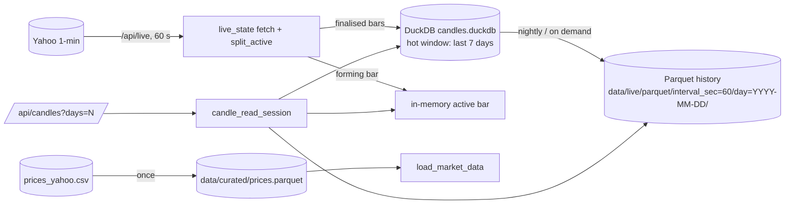

# Design: migrate time-series storage to DuckDB + Parquet

Status: **implemented 2026-10-25** (results in §8). Companion: [`DESIGN.md`](DESIGN.md) §3–4, decision D14.

## 1. Current state (what is actually there)

| Data | Store today | Read path | Latency issue |
|---|---|---|---|
| Live 1-min candles (cold) | **SQLite** `data/live/candles.sqlite` (DDL written PostgreSQL-compatible; there is no PostgreSQL server) | Only counted (`/api/live` store stats); charts never read it | — |
| Live candles for charts | In-memory `CACHE[mk]` in `api/plumber.R` | `/api/candles` calls `live_state()`, which **fetches Yahoo when the cache is older than 55 s** | Cold cache on Render: ≈ 11 s before the first chart paints |
| Daily prices (research + API start-up) | CSV `data/raw/prices_yahoo.csv` (≈ 24 MB) | `read.csv` at every start-up | Slow start-up parse |
| Research features | RDS | scripts only | none for users |
| Result tables | small CSVs | `/api/results` | none |

## 2. Goals

1. Chart requests are pure store reads (target p50 < 50 ms locally), never wait on Yahoo once the store has data.
2. Multi-session intraday history for charts (`days` parameter) from columnar storage.
3. Faster daily-price load from Parquet, with **bit-identical** data so research results reproduce exactly.
4. Same function contracts as today, so callers and tests change minimally; SQLite kept as a rollback backend.

Non-goals: moving research RDS files or result CSVs (no user-facing latency), a database server, PostgreSQL.

## 3. Target design

### 3.1 Live candle store (DuckDB)

* Same table and constraints as today (`CANDLE_DDL`); DuckDB supports `PRIMARY KEY`, `CHECK` and `INSERT … ON CONFLICT DO UPDATE`.
* Bulk upsert: register the data frame (`duckdb::duckdb_register`) and run one `INSERT … SELECT … ON CONFLICT DO UPDATE`; de-duplicate keys first (DuckDB refuses to update one row twice in a command).
* Backend chosen by `options(qstock.store_backend = "duckdb" | "sqlite")`, default `duckdb`. `candle_store_open/upsert/read` dispatch on it, so `app/app.R`, `api/plumber.R` and tests keep their calls.
* **Single-writer rule:** a DuckDB file has one read-write process. The API uses `data/live/candles.duckdb`; the Shiny app uses `data/live/candles_app.duckdb`. (SQLite allowed both on one file.)
* Memory: `SET memory_limit = '128MB'`, `threads = 1` on the 512 MB Render container.

### 3.2 Parquet history

* `candle_export_parquet(con, dir, before)` copies finalised days older than the hot window to `dir/interval_sec=60/day=YYYY-MM-DD/*.parquet` (Hive partitioning, ZSTD), then deletes them from the DuckDB table. Idempotent: a day is rewritten whole (`OVERWRITE_OR_IGNORE`).
* `candle_read_range(con, tickers, interval_sec, since, until, parquet_dir)` unions DuckDB and `read_parquet(…, hive_partitioning = true)` with partition pruning on `day`.

### 3.3 API change (the latency fix)

* `/api/candles/<market>/<ticker>?days=1` reads from the store plus the in-memory forming bar. It triggers a Yahoo fetch **only** if the store has no rows for that ticker (cold boot), not on every stale cache.
* `/api/live` stays the single place that polls Yahoo and writes the store; the UI already polls it every 60 s.
* Response shape unchanged (`days` optional, default 1 = latest session), so `web/src/lib/api.ts` and the snapshot need no change.

### 3.4 Daily prices (Parquet)

* `data/curated/prices.parquet` written from the CSV-loaded frame; `load_market_data()` reads Parquet when present and newer than the CSV, else the CSV (and writes the Parquet cache).
* Equality test: `identical()` on the frame from CSV and from Parquet (types, column order, values).

## 4. Migration and rollback

1. `scripts/29_migrate_sqlite_to_duckdb.R`: copy `candles.sqlite` → `candles.duckdb`, verify row count and per-ticker checksums (sum of close, min/max bucket), optionally export old days to Parquet. Re-runnable.
2. `scripts/30_prices_to_parquet.R`: write and verify `prices.parquet`.
3. `scripts/31_storage_benchmark.R`: SQLite vs DuckDB vs Parquet for one-ticker session read, all-ticker read, aggregate, daily-price load → `results/tables/storage_benchmark.csv`.
4. Rollback: `options(qstock.store_backend = "sqlite")`; the SQLite file is left untouched by the migration.

## 5. Deployment

* `deploy/render/Dockerfile`: add `duckdb` to `install2.r` (P3M binary on rocker). Render's disk is ephemeral: the DuckDB store starts empty after each deploy or restart, so the first chart per ticker still needs one fetch; afterwards reads are local.
* Vercel: no change.

## 6. Risks

| Risk | Mitigation |
|---|---|
| Two processes open one DuckDB file | Separate files per process (3.1) |
| OneDrive locks/sync on `data/live` | Already git-ignored; option `qstock.live_db` can point outside OneDrive |
| Image size / memory on Render | duckdb binary ≈ 40 MB; memory_limit 128 MB; measure after deploy |
| Research reproducibility | Prices Parquet is verified `identical()` to the CSV frame; research scripts otherwise untouched |

## 7. Work split (parallel)

| Stream | Files (exclusive) |
|---|---|
| A. DuckDB store + Parquet history | `R/store_duckdb.R`, `tests/testthat/test_store_duckdb.R` |
| B. Daily prices Parquet | `R/data_adapter.R`, `scripts/30_prices_to_parquet.R`, `tests/testthat/test_prices_parquet.R` |
| C. Migration + benchmark | `scripts/29_migrate_sqlite_to_duckdb.R`, `scripts/31_storage_benchmark.R` |
| D. Wiring (lead) | `R/live_market.R`, `api/plumber.R`, `app/app.R`, `deploy/render/Dockerfile`, `tests/test_api.R`, docs |

## 8. Results (measured 2026-10-25, Windows laptop)

**Migration** (`scripts/29_migrate_sqlite_to_duckdb.R`): 75,169 candles, 40 ticker groups, counts and per-ticker checksums equal; SQLite 7.88 MB → DuckDB 5.26 MB. The data span only 7.3 days, so the default 7-day hot window exported nothing to Parquet yet; export was verified on a copy (3-day window: 30,062 rows to 2 day partitions, table + Parquet = source, re-runs do not duplicate). DuckDB files do not shrink after DELETE, so the script compacts (`COPY FROM DATABASE`) after an export.

**End to end** (real Yahoo feed, local API, migrated store):

| Request | Before (fetch on stale cache) | After (store read) |
|---|---|---|
| `/api/candles/NSE/RELIANCE.NS`, cold | 6.6 s (Yahoo fetch; ≈ 11 s on Render) | 0.09 s first call, 0.04–0.06 s after |
| `/api/candles/...?days=5` (1,809 bars) | not available | 0.06 s |

**Storage engines** (`scripts/31_storage_benchmark.R` → `results/tables/storage_benchmark.csv`, median of 20):

| Query | SQLite | DuckDB | Parquet |
|---|---|---|---|
| One ticker, latest session (391 rows) | **0.62 ms** | 1.23 ms | 5.6 ms |
| One ticker, 5 sessions | 1.97 ms | **1.36 ms** | 6.2 ms |
| One market, latest session (7,236 rows) | 7.28 ms | **3.15 ms** | 8.0 ms |
| Daily roll-up of 1-min candles | 83 ms | **6.3–13 ms** | 8.7–14 ms |
| Daily prices load (117,660 rows) | CSV 367–950 ms | — | **25–30 ms** |

Reading of the numbers: for a single-session chart both engines are sub-millisecond-scale and irrelevant next to HTTP; the user-visible gain comes from serving charts from the store rather than waiting on Yahoo. DuckDB wins as queries grow (multi-session, whole market, aggregates), and opening a DuckDB connection costs ≈ 19 ms, so the API keeps one long-lived connection. Parquet suits history and scans, not point reads.

**Tests:** 51 testthat blocks / 234 expectations, 20 API end-to-end checks (including `days` and cold-store), Shiny server tests: all pass. Not yet measured on Render (threads = 1, 128 MB limit); the store there is empty after each deploy, so the first chart per market performs one fetch.

**Not implemented (follow-ups):** automatic periodic export to Parquet inside the API (run `scripts/29_migrate_sqlite_to_duckdb.R --export-before-days N` or call `duck_export_parquet()`); the Web UI does not yet request `days > 1`.
